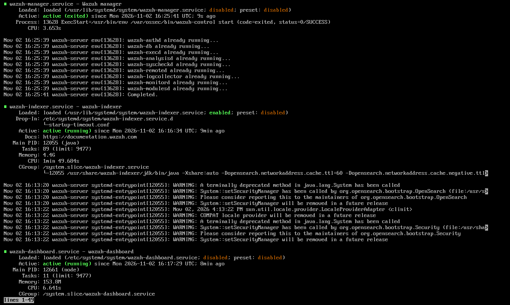
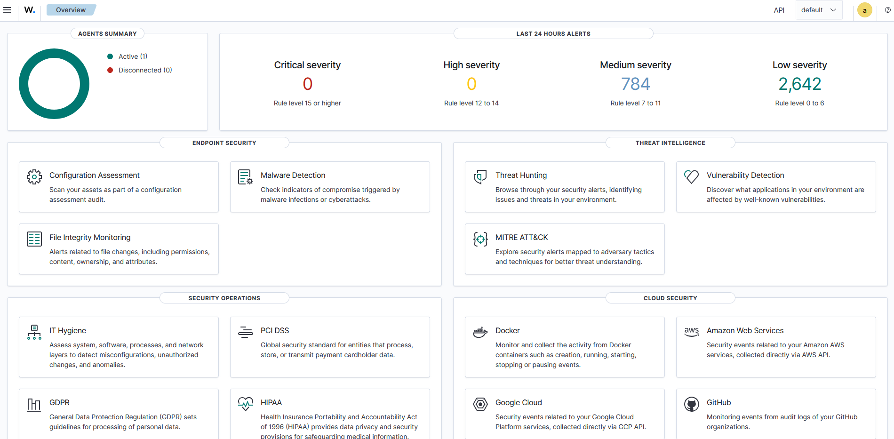
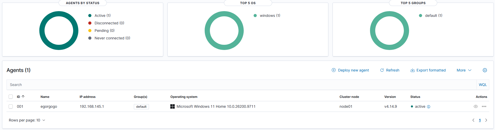
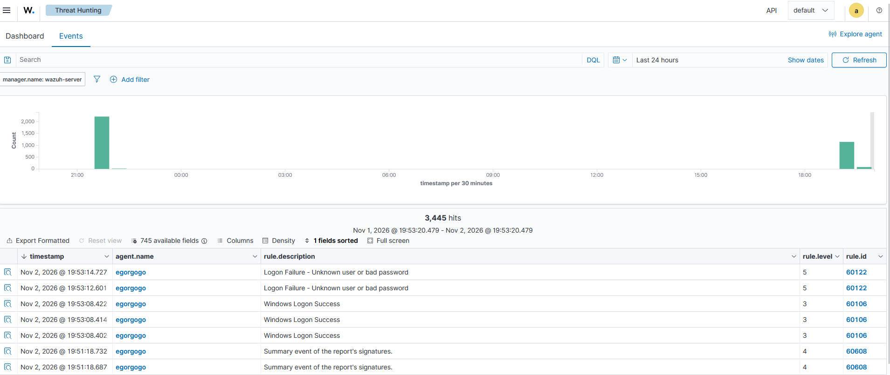
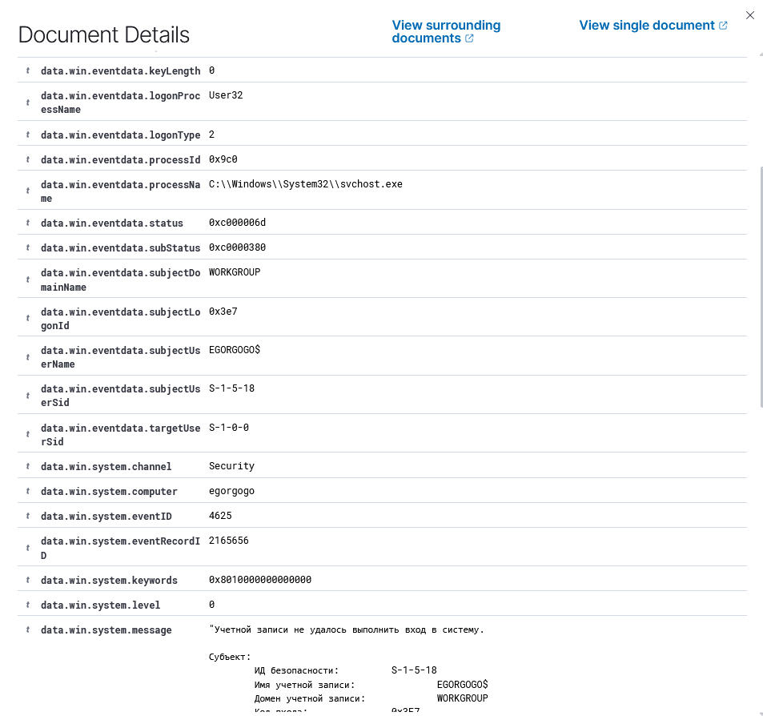
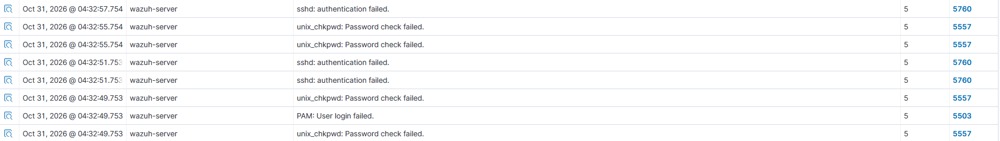
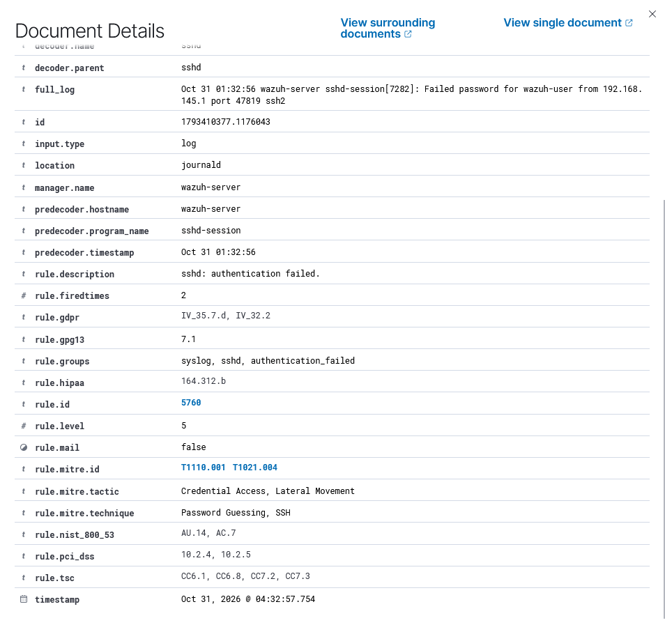

# Установка и настройка Wazuh SIEM

В рамках данного проекта я решил самостоятельно развернуть домашнюю лабораторию на базе Wazuh SIEM, чтобы разобраться в принципах работы систем мониторинга информационной безопасности и получить практический опыт, приближенный к задачам SOC Analyst.

Основная идея заключалась не просто в установке SIEM, а в создании небольшой инфраструктуры, которая позволяет собирать события с конечных устройств, анализировать их и выявлять потенциально подозрительную активность.

В качестве сервера мониторинга был выбран Wazuh. Для сбора событий с пользовательского устройства использовался Windows Agent.

Проект постепенно развивается: после первоначальной настройки инфраструктуры планируется изучение File Integrity Monitoring, интеграция Sysmon, анализ уязвимостей и другие практические задачи.
## Цели

- Разобраться в архитектуре Wazuh и принципах работы SIEM.
- Получить практический опыт установки и настройки Wazuh Server.
- Научиться подключать конечные устройства через Wazuh Agent.
- Организовать сбор событий безопасности Windows.
- Научиться находить и анализировать события в Dashboard.
- Разобраться в механизме работы правил обнаружения и формирования алертов.
- Постепенно расширять лабораторию новыми источниками данных и механизмами обнаружения.


## Подготовка и установка

Первым этапом стала подготовка виртуальной машины, на которой впоследствии был развёрнут Wazuh Server.

Необходимо было подготовить систему и обеспечить доступ к интерфейсу управления. Также в процессе установки пришлось отдельно разбираться с ошибками различных служб.

Первая служба - wazuh-indexer. Суть проблемы заключалась в том, что при попытке запуска службы wazuh-indexer процесс завершается по таймауту. Служба переходит в состояние failed или циклически перезапускается. Решением стало добавление файла конфигурации в папку с помощью команд ```sudo mkdir /etc/systemd/system/wazuh-indexer.service.d``` и ```echo -e "[Service]\nTimeoutStartSec=180" | sudo tee /etc/systemd/system/wazuh-indexer.service.d/startup-timeout.conf```.

Вторая служба - wazuh-manager. Решением могло стать все то же добавление файла конфигурации, но я решил обойтись обычным запуском файла менеджера. ```sudo /var/ossec/bin/wazuh-control start```



После подготовки системы был установлен Wazuh и выполнен первый вход в Dashboard.




## Подключение Windows Agent

После развёртывания сервера следующим этапом стало подключение Windows-устройства.

Для этого на Windows была установлена служба Wazuh Agent, настроено подключение к серверу и проверена передача данных.

После запуска службы агент появился в списке подключённых устройств в Dashboard.



## Первичная проверка сбора событий

После подключения агента необходимо было убедиться, что Wazuh действительно получает и обрабатывает события с Windows.



Для этого были изучены события безопасности, связанные с авторизацией пользователей.

Особое внимание уделялось следующим событиям:

| Event ID | Значение |
| ------------- | ------------- |
| 4624    | Успешный вход в систему    |
| 4625    | Неудачная попытка входа    |

В Dashboard удалось обнаружить соответствующие события и изучить связанные с ними сведения.



## Дополнительная проверка SSH-авторизации

Для проверки обработки событий Linux была проведена контролируемая проверка SSH-авторизации на собственном Wazuh Server.

При анализе результата было обнаружено событие неудачной авторизации SSH.



Важный момент: в Dashboard событие отображалось от имени самого сервера с ID агента 000. Это ожидаемо, поскольку попытка авторизации происходила непосредственно на Wazuh Server, а не на Windows Endpoint.



В событии были обнаружены сведения о неудачной авторизации, источнике подключения и имени пользователя.

Также Wazuh связал событие с соответствующими техниками MITRE ATT&CK, включая T1110.001 (Password Guessing) и T1021.004 (SSH).

Эта проверка помогла лучше разобраться в том, как Wazuh связывает события с источниками данных и применяет правила обнаружения.
## Полученные навыки

В ходе работы удалось получить практический опыт:

- Развёртывания Wazuh SIEM в виртуальной среде.
- Первичной настройки серверной инфраструктуры.
- Подключения и проверки Windows Agent.
- Диагностики сетевого соединения.
- Работы с Windows Security Events.
- Анализа событий успешной и неудачной авторизации.
- Работы с правилами обнаружения Wazuh.
- Первичного знакомства с MITRE ATT&CK.
- Анализа событий SSH-аутентификации.
## Итог

В результате была создана работающая домашняя лаборатория Wazuh SIEM с подключённым Windows Endpoint.

Удалось пройти путь от первоначальной подготовки виртуальной машины до получения и анализа событий безопасности из разных источников.

Проект будет развиваться дальше. Основной акцент следующих этапов будет сделан на практическом анализе событий, выявлении подозрительной активности и понимании принципов работы SOC.
