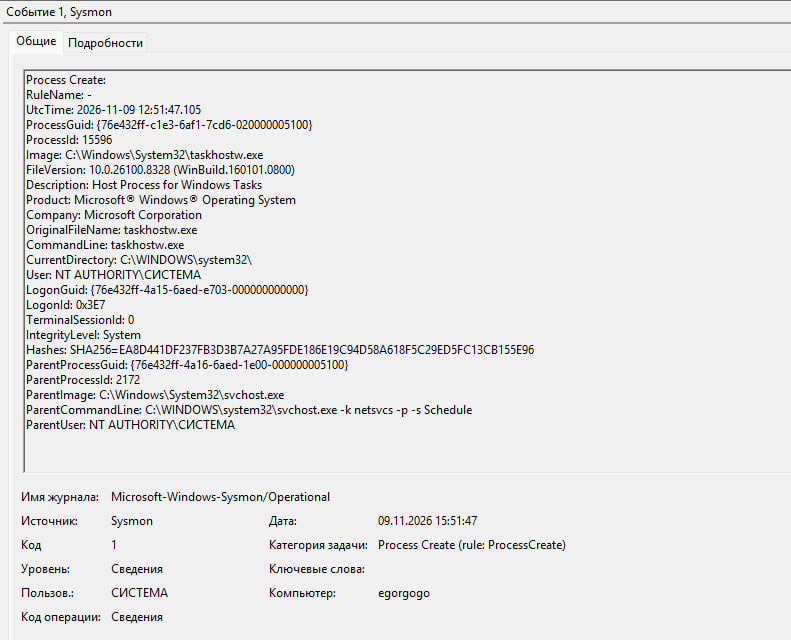
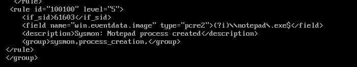
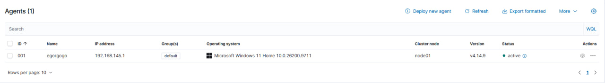
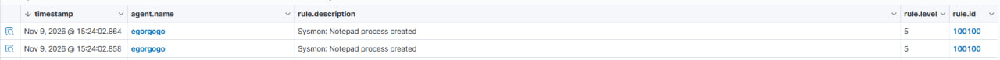
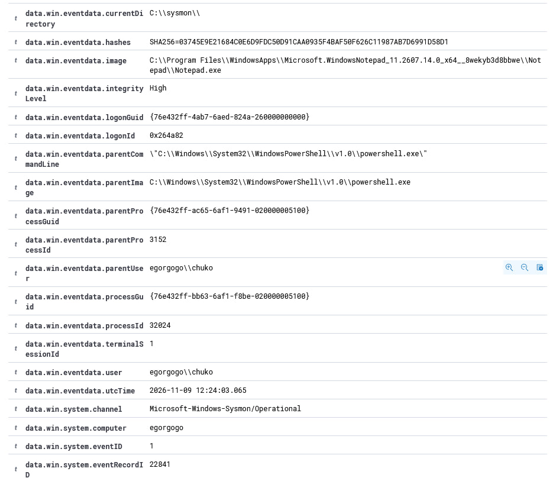
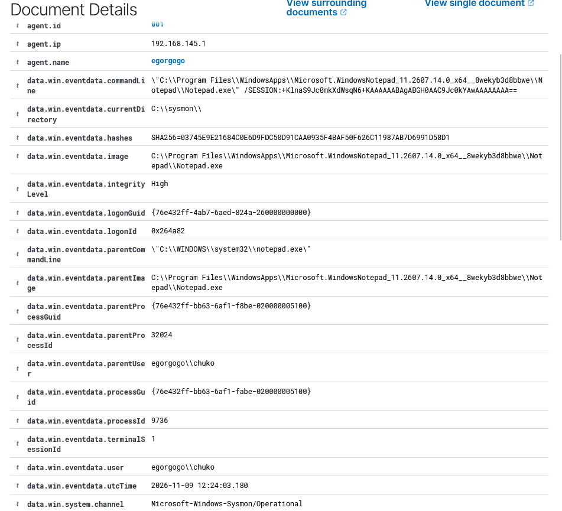

# Sysmon Integration с Wazuh

## 1. Цель работы

Интеграция Sysmon с Wazuh SIEM для расширенного мониторинга активности Windows Endpoint, получение событий создания процессов и разработка собственного правила обнаружения.

## 2. Используемое окружение

- Windows 11: конечная система.
- Sysmon: сбор системных событий.
- Wazuh Agent: передача событий на сервер.
- Wazuh Manager: обработка и анализ событий.
- Wazuh Dashboard: просмотр результатов мониторинга.

## 3. Установка Sysmon

На Windows Endpoint был установлен Sysmon из набора Microsoft Sysinternals.



## 4. Интеграция Sysmon с Wazuh

Для передачи событий Sysmon в Wazuh Agent была добавлена следующая конфигурация в `ossec.conf`:

```xml
<localfile>
    <location>Microsoft-Windows-Sysmon/Operational</location>
    <log_format>eventchannel</log_format>
</localfile>
```



После изменения конфигурации была перезапущена служба Wazuh Agent.



Проверил поступление событий Sysmon на Wazuh Manager.

## 5. Разработка пользовательского правила

Для обнаружения создания процесса Notepad было разработано пользовательское правило Wazuh.

Rule ID: `100100`

Уровень: `5`

Родительское правило: `61603`

Конфигурация:

```xml
<rule id="100100" level="5">
    <if_sid>61603</if_sid>
    <field name="win.eventdata.image" type="pcre2">(?i)\\notepad\.exe$</field>
    <description>Sysmon: Notepad process created</description>
    <group>sysmon,process_creation,</group>
</rule>
```

### Логика правила

- `if_sid`: использование базового правила обработки события создания процесса Sysmon.
- `win.eventdata.image`: проверка пути к исполняемому файлу.
- `pcre2`: применение регулярного выражения.
- `(?i)`: поиск без учёта регистра.
- `\\notepad\.exe$`: совпадение с именем Notepad.exe в конце пути.

Перед применением проверил корректность конфигурации:

```bash
sudo /var/ossec/bin/wazuh-analysisd -t
```

После успешной проверки перезапустил Wazuh Manager.

## 6. Тестирование правила

Для проверки правила на Windows Endpoint был запущен Notepad.

После запуска в Wazuh Dashboard появилось событие с пользовательским правилом:

- Rule ID: `100100`
- Description: `Sysmon: Notepad process created`
- Level: `5`



Таким образом, удалось проверить полный цикл: создание процесса на Windows Endpoint, сбор события Sysmon, передача события в Wazuh и формирование alert по пользовательскому правилу.




## 7. Результат

В ходе работы:

- Установил Sysmon на Windows 11.
- Настроил передачу Sysmon Operational Log в Wazuh.
- Проверил получение событий создания процессов.
- Разработал пользовательское правило обнаружения.
- Проверил срабатывание правила на тестовом событии.

## 8. Полученные навыки

- Работа с Sysmon.
- Анализ событий Windows.
- Интеграция источников событий с Wazuh SIEM.
- Работа с XML-конфигурациями.
- Создание пользовательских правил обнаружения.
- Использование регулярных выражений PCRE2.
- Проверка и тестирование правил Wazuh.
